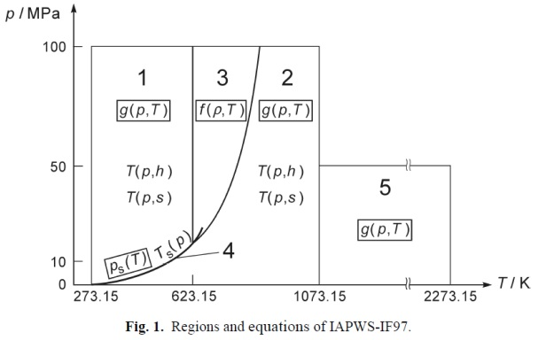

# IF97 Python

Свойства воды и водяного пара по стандарту [IAPWS-IF97](https://iapws.org/relguide/IF97-Rev.html).
Ядра компилируются numba, один и тот же код обслуживает скаляры и массивы.

## Установка

```bash
pip install git+https://github.com/Sam-Strand-org/if97_py.git
```

## Быстрый старт

```python
from if97 import if97

# область определяется автоматически
s = if97.state_t_p(773.15, 24.0)       # 500 °C, 24 МПа
print(s.h, s.s, s.cp, s.w)

# одно свойство
h = if97.h_t_p(773.15, 24.0)

# массивы — один вызов на весь массив
import numpy as np
t = np.linspace(300, 900, 1_000_000)
s = if97.state_t_p(t, 10.0)            # broadcasting работает

# конкретная область, без проверки принадлежности
h = if97.water.h.t_p(300.0, 3.0)

# обратные уравнения: температура по давлению с энтальпией или энтропией
if97.water.t.p_h(3., 500.)         # 391.798509 K
if97.steam.t.p_s(8., 6.)           # 600.484040 K

# линия насыщения
p_s = if97.saturationPressure_t(373.15)
t_s = if97.saturationTemp_p(0.101325)

# двухфазная смесь
m = if97.mix.state.p_x(0.1, 0.95)      # v, rho, h, s, u
x = if97.mix.x.p_h(0.1, 2500.0)
```

`state_t_p` возвращает все восемь свойств за один обход таблицы коэффициентов
и стоит столько же, сколько одно `h`. Восемь отдельных вызовов повторят один и
тот же обход восемь раз, поэтому для массивов используйте `state`.

## Области

| № | Модуль | Описание | Диапазон |
|---|--------|----------|----------|
| 1 | `water` | вода | 273.15–623.15 K, `p_s(T)`–100 МПа |
| 2 | `steam` | перегретый пар | 273.15–1073.15 K, до 100 МПа |
| 3 | `fluid` | сверхкритический флюид | 623.15 K – граница B23, до 100 МПа |
| 4 | `mix` | пароводяная смесь | линия насыщения |
| 5 | `gas` | высокотемпературный пар | 1073.15–2273.15 K, до 50 МПа |



Обратное уравнение `v(p, T)` области 3 реализовано по
[IAPWS SR5-05](https://iapws.org/relguide/Supp-VPT3-2016.pdf), все 26 подобластей.

## Раскладка

Структура повторяет структуру стандарта: у каждой области свои коэффициенты,
свой потенциал и по файлу на свойство.

```
if97/
  saturation.py      линия насыщения, ур. (30), (31)
  b23.py             граница областей 2 и 3, ур. (5), (6)
  b2bc.py            граница подобластей 2b и 2c, ур. (20), (21)
  bounds.py          публичные границы и region_t_p
  _poly.py           лестницы степеней для обратных уравнений
  auto.py            автовыбор области (единственное, что тянет всё сразу)
  water/
    tables.py        коэффициенты, Таблица 2
    gibbs.py         γ и шесть производных за один обход
    h.py s.py v.py   по файлу на свойство, формула видна в файле
    ...
    state.py         все восемь свойств сразу
    tables_backward.py  коэффициенты обратных ур., Таблицы 6, 8
    t.py             T(p,h) и T(p,s), ур. (11), (13)
  steam/ gas/        то же (γ⁰ + γ^r); у steam ещё t.py, ур. (22)-(27)
  fluid/
    tables.py        Таблица 30 + коэффициенты SR5-05
    helmholtz.py     φ и производные
    subregion.py     дерево 3a..3z и v(p, T)
    ...
  mix/
    phases.py        состояния кипящей жидкости и сухого пара
    ...
```

Импорт ленивый: `import if97` ничего не компилирует, `if97.water.h` поднимает
только область 1, `if97.state_t_p` — все области. Проверяется тестом
`test_lazy_imports`.

## Свойства

Каждая область даёт `v`, `rho`, `h`, `s`, `u`, `cp`, `cv`, `w`, а `state` —
все сразу. Единицы: p [МПа], T [K], v [м³/кг], rho [кг/м³], h и u [кДж/кг],
s, cp, cv [кДж/(кг·K)], w [м/с].

Для смеси (область 4) определены только `v`, `rho`, `h`, `s`, `u`: в двухфазной
области линейно интерполируются лишь экстенсивные свойства.

Область 3 принимает и `t_p`, и `t_rho`; `fluid.p.t_rho` даёт давление по
температуре и плотности.

## Обратные уравнения

Области 1 и 2 дают температуру по давлению с энтальпией или энтропией:
`water.t.p_h`, `water.t.p_s`, `steam.t.p_h`, `steam.t.p_s`. Это уравнения
(11), (13) и (22)-(27) стандарта.

Они не обращения, а подгонки: стандарт сам отводит им допуск **25 мК**
относительно прямых уравнений и не требует большего. Там, где нужна полная
точность, подгонка годится как начальное приближение для итерации по
прямому уравнению.

Область 2 для этого разбита на три подобласти — 2a ниже 4 МПа, 2b и 2c
выше, — и выбор делается внутри: для `p_h` по линии B2bc (`bounds.b2bcEnthalpy_p`),
для `p_s` по значению s = 5.85 кДж/(кг·K). Ниже 6.546 70 МПа подобласти 2c
не существует, и ветка закрыта проверкой: уравнение (21) там дало бы корень
из отрицательного числа.

## Производительность

Замерено `tests/bench_head2head.py` против [RustSEUIF97](https://github.com/thermalogic/RustSEUIF97),
точек в секунду, один поток. «Массив» — один вызов на все точки, «точка» —
вызов на точку.

Прямые уравнения:

| | if97 | seuif97 | |
|---|---|---|---|
| область 1, `w`, массив | 6 996 513 | 5 070 550 | **1.38x** |
| область 1, состояние, массив | 6 907 424 | 1 839 651 | **3.75x** |
| область 2, `w`, массив | 4 765 495 | 4 759 149 | 1.00x |
| область 2, состояние, массив | 4 549 646 | 1 665 839 | **2.73x** |
| область 3, `v`, массив | 10 684 551 | 3 132 673 | **3.41x** |
| область 3, состояние, массив | 4 574 462 | 662 727 | **6.90x** |
| область 5, состояние, массив | 8 750 633 | 2 215 107 | **3.95x** |
| линия насыщения `p_s(T)`, массив | 665 805 556 | 9 283 975 | **71.7x** |
| линия насыщения `T_s(p)`, массив | 295 040 951 | 7 461 551 | **39.5x** |
| область 1, `w`, точка | 1 748 425 | 4 570 195 | 0.38x |
| область 3, `v`, точка | 1 877 138 | 2 348 845 | 0.80x |
| область 3, состояние, точка | 751 752 | 564 997 | **1.33x** |

Обратные уравнения:

| | if97 | seuif97 | |
|---|---|---|---|
| область 1, `T(p,h)`, массив | 24 919 507 | 5 905 243 | **4.22x** |
| область 1, `T(p,s)`, массив | 24 492 293 | 5 619 641 | **4.36x** |
| область 2, `T(p,h)`, массив | 14 929 487 | 3 465 022 | **4.31x** |
| область 2, `T(p,s)`, массив | 17 003 641 | 2 792 183 | **6.09x** |
| область 2, подобл. 2a, `T(p,s)`, массив | 11 621 846 | 998 538 | **11.6x** |
| область 2, подобл. 2a, `T(p,s)`, точка | 1 949 893 | 967 438 | **2.02x** |
| область 1, `T(p,h)`, точка | 2 223 683 | 5 241 280 | 0.42x |

Числа обратных уравнений сходятся с `seuif97` до машинной точности (худшее
расхождение 3.6e-12, то есть ноль милликельвинов), так что считаются там те
же уравнения стандарта без уточняющей итерации. Но `ph2t`/`ps2t` у `seuif97`
сами определяют область по (p,h), а `water.t.p_h` и `steam.t.p_h` — нет: они
работают по областям, как и прямые уравнения. На этой части if97 делает
меньше работы, и чистым сравнением уравнение-против-уравнения эти отношения
не являются.

На массивах быстрее, на одиночных вызовах медленнее — и это структурно.
Переход Python → numba стоит около 300 нс на вызов и не зависит от того,
что считается; у скомпилированного расширения с одной сигнатурой он дешевле.
Зато массив пересекает границу один раз на все точки, а у `seuif97` нет
массивного API, так что на сетке он платит вызов за каждую точку. Чем короче
само уравнение, тем сильнее это видно: на линии насыщения, где считать почти
нечего, разрыв доходит до семидесяти раз.

Состояние целиком особенно выгодно: восемь свойств снимаются с одного обхода
таблицы, тогда как четыре отдельных вызова `seuif97` — это четыре перехода
через FFI. В области 3 этого хватает, чтобы выиграть даже поточечно.

Холодный старт — 60 мс на импорт и ещё ~360 мс при первом обращении к любой
области (numba загружает скомпилированный код); следующие области добавляют
по ~10 мс, обратные уравнения — ~5 мс. Всё вместе, включая обратные и
автовыбор области, — 459 мс. У `seuif97` 0.5 мс: он собран заранее. Если
важен быстрый старт коротких процессов, это аргумент против.

Точечный и пакетный расчёт могут расходиться в последнем бите: это две
отдельные компиляции одного ядра, и под `fastmath` LLVM в цикле
переассоциирует сумму иначе.

## Что проверяется

`tests/test_if97.py` сверяет расчёт с контрольными значениями стандарта
(Таблицы 5, 7, 9, 15, 24, 29, 33, 35, 36, 42 и контрольные точки B23 и B2bc)
и дополнительно проверяет то, чего в таблицах нет: `rho·v = 1`, восстановление
давления из уравнения Гельмгольца по `v(p,T)` области 3, критерий Максвелла
`g' = g''` на линии насыщения, замкнутость `x(p,h)` относительно `h(p,x)`,
совпадение скалярного и массивного путей, круговой обход `T(p, h(p,T))` против
допуска 25 мК и выбор подобласти 2a/2b/2c против прямого вызова её уравнения.

```bash
python tests/test_if97.py
```

## Чего пока нет

Из самого IF97-Rev — только метастабильного пара (ур. (18)).

Остальное лежит в отдельных дополнительных выпусках IAPWS и в этот документ
не входит: обратные уравнения области 3 `T(p,h)` и `v(p,h)` (SR3-03),
`T(p,s)` и `v(p,s)` (SR4-04), `p(h,s)` (SR2-01), уравнения границы областей
3 и 4 (SR5-05 частично реализован — `v(p,T)` области 3), а также вязкость,
теплопроводность и поверхностное натяжение.
